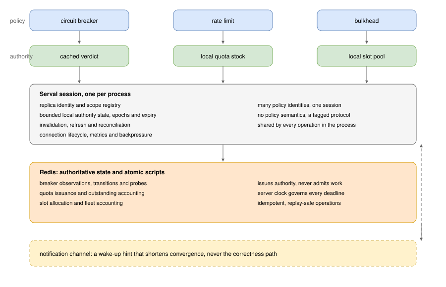

# Serval: delegated coordination

Serval is an **opt-in, explicitly approximate** coordination strategy for Caracal's distributed
policies. It keeps Redis as the authority for shared policy state and allocation accounting, but
lets each process enforce locally held, time-bounded *authority* on the request path. The ordinary
admission path then needs no Redis round trip while valid local authority exists.

> **Status: experimental.** The strategy ships as the opt-in
> [`@gkoos/caracal/serval`](api.md) entry point. This page and [Serval authority
> protocol](authority.md) are the specification - the contracts, the guarantees and the
> deviations; [the API page](api.md) is the reference for using it, and
> [the fault lab](benchmarks.md) carries the measured trade-offs and the operating
> envelopes. The strict Redis coordinators (`redisCoordinator`, `redisCircuitBreakerCoordinator`,
> `redisRateLimitCoordinator`) remain the default distributed implementations.

Serval is deliberately different from the strict Redis coordinators rather than interchangeable with
them. The strict breaker presumes a per-admission read, and the strict rate limiter and bulkhead
presume a per-action call; a delegated coordinator answers those calls from locally held authority
instead, and states the resulting consistency and failure differences as a deviation envelope. The
strict implementations are untouched, and a policy composed around one keeps its admission semantics.

## Core invariants

| Invariant | Meaning |
|---|---|
| No knowingly expired authority | A process never initiates new work on an allocation whose conservative deadline, anchored to the acquisition request **send time**, has passed. A late response cannot extend validity. |
| Monotonic state application | Older epochs or state versions never overwrite newer cached state. |
| No double allocation while authority history is intact | Redis reserves outstanding quotas and slots atomically and deduplicates ambiguous retries. A failover or restore that loses acknowledged issuance may permit overlapping grants; that is a documented deviation, measured separately. |
| Scope isolation | Authority for `(policy kind, policy name, operation, scope)` never authorises another identity. |
| Conservative unknown state | A missing or invalid local grant is never silently treated as a valid one; the policy follows its documented degraded behaviour. |
| Independent local guardrails | A Serval admission never bypasses a composed local policy. |
| Distinct accounting | Observability distinguishes tracked occupancy, Redis-accounted allocation and physical downstream work, and distinguishes approximate fleet targets from local tracked-occupancy ceilings. |
| No unsafe eviction | Active allocations, consumed-quota accounting, pending acquisitions, holder records and protective breaker state are never discarded to meet a cache bound. |
| Configuration changes are not instantaneous revocations | Disconnected clients may spend previously issued authority until its conservative expiry; new issuance accounts for outstanding grants or pauses. |

## Architecture



One **session per process** owns the connection lifecycle, the notification subscription, the bounded
caches, refresh scheduling and cleanup. A session may serve many policy identities. The shared
infrastructure never interprets policy semantics; it carries a small tagged protocol internally
(`BreakerVerdict | RateGrant | BulkheadAllocation`) with policy-specific operations and lifecycle
rules.

### Identity and ownership

- **Authority key:** `(namespace, policy kind, policy name, operation, scope)`, retaining the current
  hash-tagging and cluster-slot scheme so one identity's keys stay in one slot.
- **Replica ID:** stable for a process lifetime. A restart receives a new **incarnation**, and is
  never entitled to its predecessor's grants.
- **Record fields:** each authority record carries `authorityIncarnation`, `epoch`, `version` (where
  relevant), `grantId`, `operationId`, `leaseRevision`, `issuedAt`, `expiresAt`, `configRevision`
  and a policy-specific payload.
- **Two distinct revision spaces:** state revisions and configuration revisions. A configuration
  change rolls authority forward or invalidates it; it never silently reinterprets an old grant.

### Grant validity is anchored to the request send time

A client timestamps the start of each acquisition request with a **monotonic** clock. A reply carries
the server-issued validity duration; the client computes

```text
deadline = requestStartedAt + validForMs - safetyMarginMs
```

and never `receivedAt + validForMs`. A reply that arrives after `deadline` is unusable. Retries and
duplicate replies for the same operation preserve that operation's original request-start anchor;
they must not extend it. Only a *distinct, successful renewal* may extend a grant, under a higher
`leaseRevision`. Redis server time governs issuance and accounting, but client wall-clock
synchronisation is **not** assumed.

A Redis-stored epoch cannot survive a rollback of the same data set. Incarnation identifiers are
fencing and diagnostic metadata, not proof of instant revocation. See
[Serval authority protocol](authority.md) for the state machines and the worked examples.

## Contracts

Eleven contracts pin the behaviour, each with a falsifiable statement and an acceptance group in the
test suite. [The authority protocol](authority.md) states them in full, with the state machines and
the worked examples; the table below is the index.

| Contract | What it pins |
|---|---|
| 1. Send-time anchoring | Validity is anchored to the request send time, so a late or duplicate reply can never extend authority |
| 2. Cached-OPEN cooldown | A cached OPEN rejects locally until its cooldown elapses, then one coalesced probe asks the authority |
| 3. Authority-history loss | A rollback resumes issuance as a documented deviation unless an independently verified fence justifies a holdoff |
| 4. Configuration revision | A revision change never revokes issued authority retroactively; a limit reduction pauses issuance until the deficit clears |
| 5. Pinned records and tombstones | Pressure refuses a new scope instead of evicting live accounting, and a late reply cannot resurrect authority |
| 6. Tracked versus physical occupancy | The fleet target bounds tracked occupancy, and physical work is measured rather than claimed |
| 7. Bulkhead renew, resize and free-only return | A renewal is not a grant, a resize-down below occupancy admits nothing new, and only free slots are returned |
| 8. Rate issuance and spending envelope | Admissions are bounded by the fleet rate plus the send-time-anchored spend horizon and burst |
| 9. Freeze-before-return | Slots leaving the local pool are frozen until the server commits, and only reconciliation unfreezes them |
| 10. Fencing and monotonic adoption | A client adopts an incarnation only through an authoritative decision, never through a late message |
| 11. Identity and ordering | `grantId`, `operationId` and `leaseRevision` keep retries idempotent and stop an older reply from restoring retired capacity |

The contracts are executable. `test/support/serval/reference-model.ts` is the deterministic model the
acceptance cases and the generated histories drive, and each coordinator has a deterministic harness
plus a suite against a real Redis.

## Per-policy contracts

Each policy has a falsifiable correctness contract and a permitted-deviation envelope. "Invariant"
means a property the reference model asserts as a hard failure; "deviation" means a measured
difference from strict Redis semantics that the implementation must report rather than conceal.

### Circuit breaker: cached verdict plus centralised evidence

| Aspect | Contract |
|---|---|
| Local fast path | Cached CLOSED admits within `freshnessMs`; cached OPEN rejects until `cooldownEligibleAt`; at or after eligibility a coalesced authoritative `admitProbe()` is attempted even while OPEN is cached |
| Settlement | Classified outcome plus admission generation sent to Redis, reusing the existing window, UUID deduplication, generation checks, configuration validation and probe settlement semantics |
| Response extension | Atomic observe/settle replies return `(state, generation, version, openedAt, configRevision)` so the reporting replica refreshes without a read |
| Invariant | A cached OPEN never transitions to HALF_OPEN without an authoritative probe reservation; a settlement from an obsolete generation cannot close a newer OPEN episode |
| Deviation | Propagation delay admits extra work at the moment of failure; measured as paired excess against a reference |
| Not changed | Thresholds, windows, probe counts, classification and cancellation semantics |

Outcome settlement is **awaited in `finally`** initially, exactly as the strict coordinator does
today. Removing the admission read does not remove settlement latency, and the two improvements are
measured separately. Bounded async outcome queues or batching are a later, separately benchmarked
experiment with explicit lost-evidence and overload semantics.

### Rate limiter: delegated admission quotas

| Aspect | Contract |
|---|---|
| Server authority | One token bucket per identity (rate `R`, burst `B`); issuance deducts tokens atomically and deduplicates by `operationId` |
| Grant | `validForMs = V`, spend deadline anchored to request send time |
| Refill | Start small, replenish when local stock falls below a threshold, size requests from recent demand, expire unused grants |
| Invariant | No double spending; no local admission beyond granted quota; the rolling bound `R * (L + V) + B` holds under intact authority history |
| Deviation | Hot-replica starvation while cold replicas hold unused quota; burst distortion at boundaries; temporary excess from stale or duplicate grants |
| Explicitly not claimed | Exact distributed GCRA semantics |

Retry-after semantics: when local quota is empty but global capacity remains, the client attempts a
bounded synchronous replenish and returns `retryAfterMs` from the server hint, or the local refill
estimate when the server hint is absent. Redis rollback behaviour is covered by Contract 3.

### Bulkhead: delegated reusable slots

| Aspect | Contract |
|---|---|
| Server authority | A maximum local slot budget per replica, with `grantId`, `leaseRevision` and per-operation `operationId` |
| Local authority | The process acquires and releases within its allocation without a Redis call per operation |
| Renewal | Idempotent; never an additional grant; cannot resurrect an allocation whose authority was lost |
| Resize | Up reserves only the delta; down returns only free slots |
| Return | Freeze-before-return handoff (Contract 9) |
| Invariant | No local over-admission relative to the active allocation; expired allocation admits no new work; holders survive reconnect |
| Deviation | Expiry-based reclamation may overlap continuing work, producing measurable physical overshoot |
| Not claimed | A strict global physical concurrency bound |

## Guarantees and deviations

| Area | Stance | Evidence required |
|---|---|---|
| Breaker stale CLOSED | Short bounded freshness, explicit fail-open/fail-closed fallback | Excess admissions versus Redis outage availability |
| Breaker OPEN during outage | Retain protective rejection; authoritative probe required | Recovery time and false rejects |
| Outcome writes | Awaited initially; async or batch as a separate experiment | p99 impact, dropped evidence, overload behaviour |
| Rate semantics | Explicit approximate quota envelope, not exact GCRA | Window and burst violations, fairness |
| Rate grant sizing | Small initial grants, adaptive refill | Redis RTT versus stranded capacity under skew |
| Bulkhead reclamation | Expiry plus configurable grace | Peak and duration overshoot under partition and a slow dependency |
| Local guardrails | Recommended, independently configured | Measured bound with autoscaling and abort-unsupported work |
| High-cardinality scopes | Bounded cache and subscriptions, idle cleanup | Memory, connections, Redis key count |
| Configuration changes | Old grants remain usable until conservative expiry; issuance pauses while the deficit is outstanding | Stale-use duration, outstanding deficit, convergence |
| Redis failover or history loss | Explicit authority incarnation; a fenced last-old-issuance boundary is required for any finite holdoff, otherwise the unfenced competing-issuance deviation applies | Ledger rollback, old-primary continued issuance, repeated failover, delayed retired-incarnation replies |
| Bulkhead return handoff | Freeze free slots before the idempotent Redis reduction; keep them frozen through an uncertain outcome | Delayed or lost reply with concurrent reallocation; reconciliation before unfreeze |
| Renewal identity and ordering | Stable grant ID, per-operation ID, monotonic lease revision; serialised modification | Duplicate renewal, reordered resize, stale deadline replay, lost response |

## Fault-assumption matrix

Which invariants hold, and under what assumption. Nothing outside this table is claimed.

| Assumption | Held | Not held |
|---|---|---|
| No partition, Redis available | All invariants, including no double allocation and the rate rolling-window bound | - |
| Bounded clocks, monotonic elapsed time on the client | Send-time anchoring and conservative deadlines | - |
| Redis unreachable, breaker cached OPEN | Protective rejection; no fabricated probe | Cached-CLOSED freshness is not extended by an outage |
| Redis unreachable, breaker cached CLOSED | Within `freshnessMs` only, then the configured fallback | Unlimited admission |
| Redis unreachable, rate or bulkhead grant | Spending within the remaining conservative validity only | New issuance; no invented permits |
| Redis unreachable, grant exhausted | Configured reject or synchronous fallback | Silent fail-open without configuration |
| Client wall-clock skew | Irrelevant: only monotonic elapsed time is used | No server/client clock agreement is assumed |
| Redis history intact after reconnect | Version, epoch and live-allocation reconciliation | - |
| Redis history lost, fence verified | Bounded issuance holdoff from `T_last_old_issue` | Physical work continues past the boundary |
| Redis history lost, no fence | Explicit competing-issuance deviation, measured | No bounded overlap claim; repeated failover repeats the overlap |
| Delayed or lost notification | Eventual convergence via expiry and reconciliation | Prompt invalidation is not guaranteed |
| Process crash or retirement | Tracked occupancy for that incarnation stops growing; the ceiling is recomputed | Remote work may continue: not a physical bound |

## Lifecycle and degraded behaviour

Session states: `uninitialized`, `reconciling`, `valid`, `refreshing`, `stale`, `disconnected`,
`uncertain`, `closed`. Cold start is distinguished from a warm cache, and a Redis failure while
CLOSED is distinguished from one while OPEN.

- **`disconnected`** means the process cannot reach the authority: the subscription is down, or no
  reconciliation has ever succeeded while a read has failed.
- **`stale`** means the last successful reconciliation is older than its allowance, so cached
  authority may be outdated even though the connection is up.
- **`uncertain`** is entered on a suspected rollback - a snapshot older than what is cached, or a
  retired incarnation reappearing - or on an unfamiliar competing incarnation. It is sticky: only an
  authoritative reconciliation that sees no rollback clears it.

- **Cold start:** no local authority. The policy follows its configured cold-start behaviour; a
  missing grant is never treated as a valid one.
- **Disconnection:** local authority remains spendable until its conservative deadline; new issuance
  is unavailable. Cached protective state is retained.
- **Reconnect:** authority-incarnation, epoch and configuration reconciliation runs **before** newly
  granted authority is used. Incarnation changes do not instantly revoke grants held by disconnected
  replicas; the issuance holdoff/overlap contract applies.
- **Shutdown:** stop new admissions and relinquish best-effort. Safety never depends on a clean
  shutdown.

## Notifications

- A Redis state transition publishes a compact **versioned invalidation**, never an imperative
  unversioned state command.
- Fan-out must reach every interested process. A Redis Streams consumer group shared by replicas
  load-balances messages rather than broadcasting them, so a consumer group is **not** the fan-out
  mechanism; the design uses a per-process cursor or subscription that broadcasts.
- A write response is also a cache-refresh channel: the atomic write returns the authoritative
  versioned verdict so no second read is needed.
- Notifications can be delayed or lost; periodic reconciliation, expiry and reconnect snapshots
  provide eventual convergence.
- Serval starts with the simplest transport that is easy to validate. Streams are not committed to
  before subscriber fan-out and scope-cardinality costs are measured.

## Cache classes, cardinality and errors

- Registry entries are classified as disposable, pinned or protective (Contract 5). Live grants,
  active holders, pending requests, consumed-grant replay guards and retained protective knowledge
  are pinned or represented by a safe tombstone.
- Under memory pressure the session **refuses new scope registrations** with an observable error
  rather than evicting live accounting.
- Late replies to retired entries cannot resurrect grants; retired request identifiers stay
  protected for the replay window or are fenced by a monotonic generation.
- Cache and subscription cardinality is bounded and observable, especially for high-cardinality
  scopes, with idle cleanup.

## Composition with local policies

Serval provides approximate fleet-wide coordination; local policies provide deterministic
per-process admission ceilings. If every request traverses a local bulkhead of limit `L_i` in each
active process `i`, and the permit is held until downstream work truly completes, then tracked
occupancy is at most the sum of `L_i` over processes with tracked live holders. A local rate limiter
bounds aggregate admissions by the sum of local rates plus their burst envelopes. A local breaker
reacts to failures visible to that process even when fleet-wide evidence is delayed.

Composition must be tested for: policy ordering; retries and per-attempt admission; admission
refusals not being misclassified as downstream failures; abort-aware versus abort-unsupported
adapters; local queue behaviour; one scope shared by different operations; several policies on one
call; and local versus distributed event classification.

Recommended deployment guidance: expose Serval's approximate target alongside an optional local
guardrail recipe, not as an implicit mandatory coupling. Local limits can strand capacity, and
autoscaling changes the aggregate bound.

## Public API

`@gkoos/caracal/serval` is the published surface, and [the API page](api.md) is its reference: exports,
options, lifecycle, guarantees, failure behaviour, metrics, guardrails and migration. Every option
named there is implemented and tested. The strict factories keep working unchanged, so opting in is a
coordinator argument.

## Implementation status

The session and the three delegated coordinators are reachable only through
`@gkoos/caracal/serval`, so opting in is explicit and the strict coordinators stay the default. The
session lives in `src/coordination/serval/`, beside the three coordinators that use it, and the
measured trade-offs are in [the fault lab](benchmarks.md).

## Prior art

The circuit breaker described here - the strict coordinator and the delegated verdicts on top of it -
follows ideas from [redeye](https://github.com/laurells/redeye) (`redeye-breaker`, MIT, by Laurels Ozy
Echichinwo): a decision made atomically on the server rather than by a read-then-write, an exclusive
recovery claim whose lease bounds a hung attempt so it cannot wedge recovery, and a verdict cached
locally together with the version it was derived from, so a stale cache is detectable. Nothing here
is derived from its code - the resemblance is in the shape of the problem - and the contracts differ
where this page says they do: redeye counts a consecutive streak or an EWMA failure rate and closes
on a single successful trial, while the breaker here counts a fixed-size window above
`minimumThroughput`, requires `halfOpenSuccesses`, and discards results from a superseded generation.

Its [reliability model and
limitations](https://github.com/laurells/redeye#reliability-model--limitations) is the kind of
writing this page's [guarantees and deviations](#guarantees-and-deviations) aims at: say what is
solved, say what is not, and measure what it costs.
